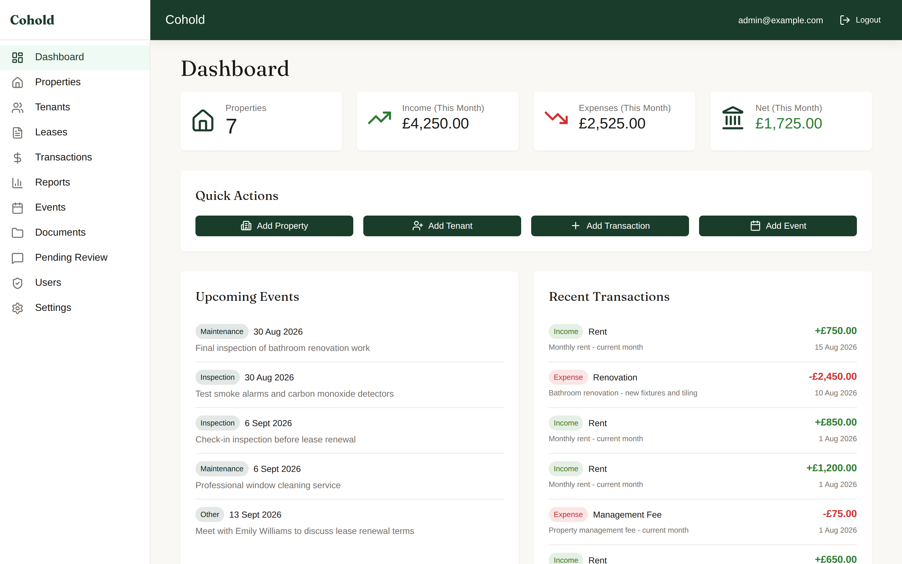
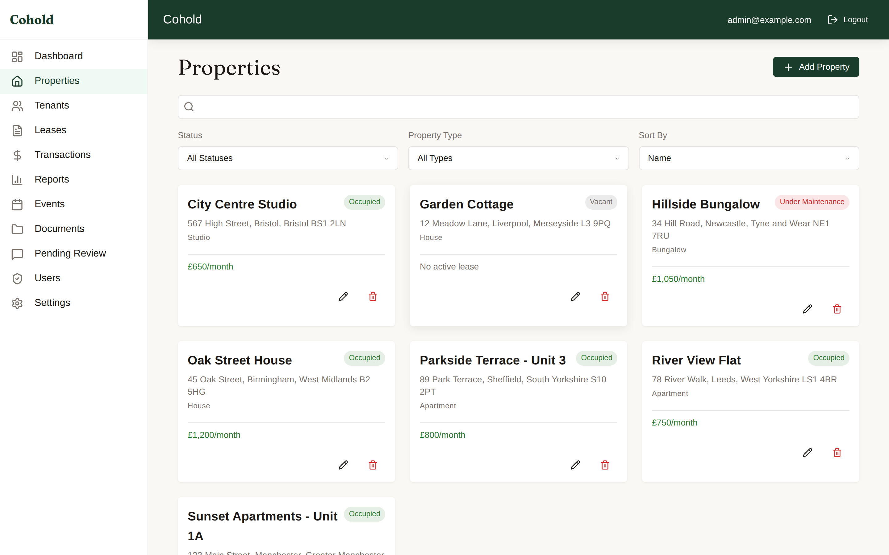
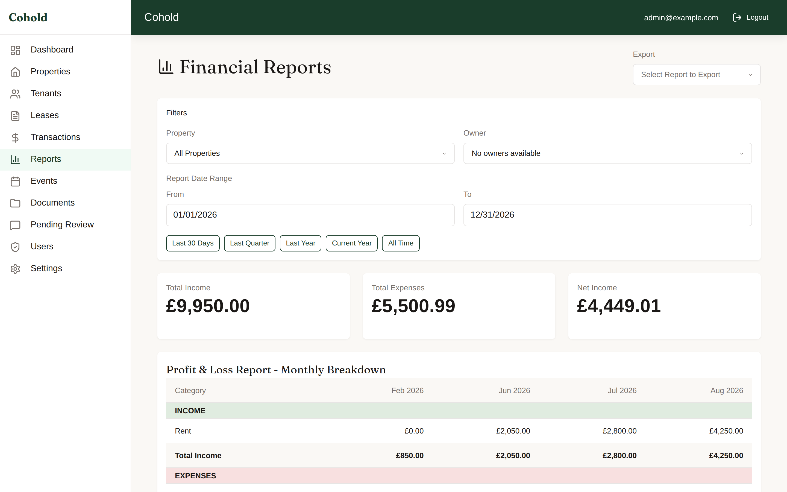
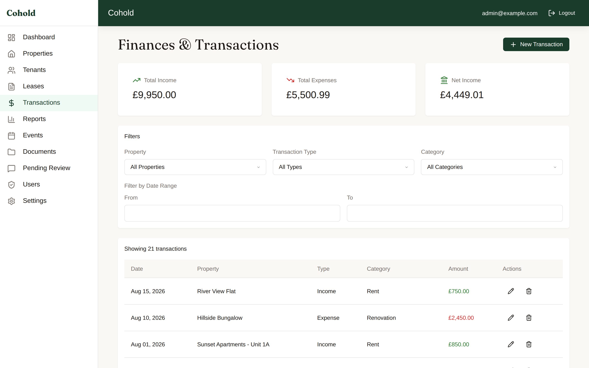
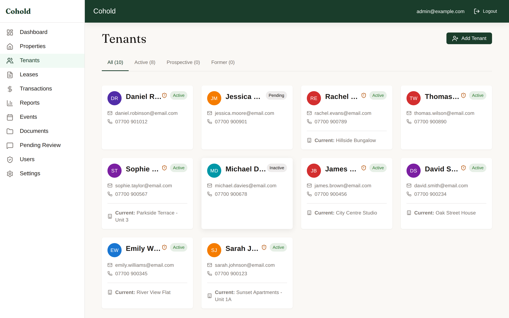
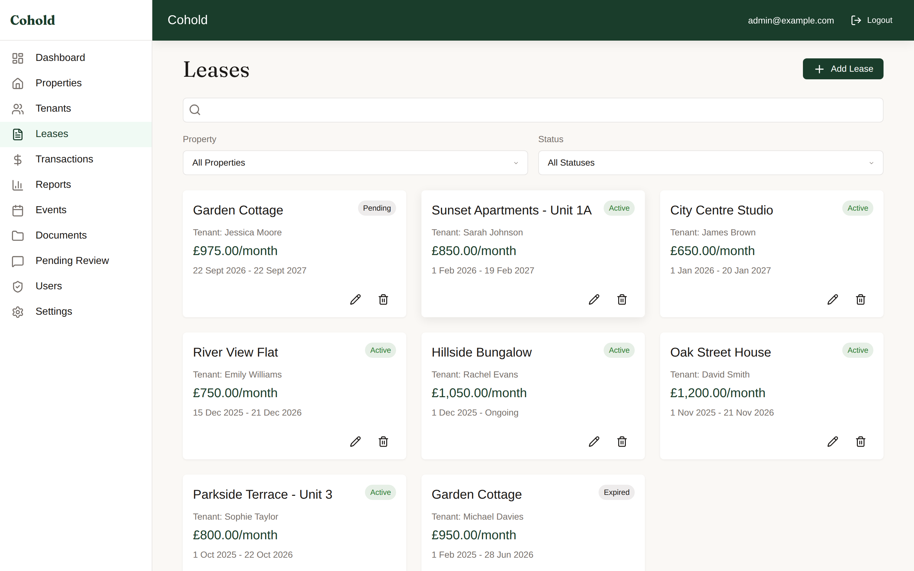
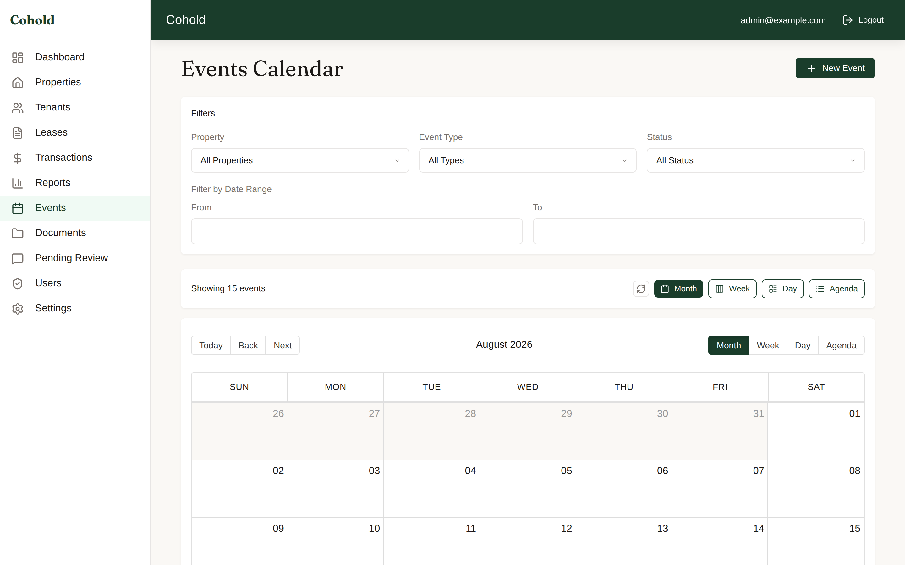

# Cohold

Self-hostable property management software for landlords.

Cohold tracks properties, tenants, leases, transactions and documents in one
place, with optional bank integration that matches real transactions against the
rent you are owed. It runs on SQLite and a single Node process, so a small VPS or
a Raspberry Pi is enough.

[](./LICENSE)

---

## Features

- **Properties** — portfolio records, per-property detail views, and multi-owner
  ownership splits with settlement tracking between co-owners.
- **Tenants & leases** — tenant records, lease terms linking tenant to property,
  and rent schedules.
- **Transactions** — income and expenses per property, optionally attributed to a
  lease, with splits across owners and a full audit log.
- **Bank integration** — connect a Monzo account over OAuth, sync transactions via
  webhooks, and auto-match them to expected rent using configurable matching
  rules. Unmatched items land in a pending queue for review.
- **Documents** — upload and attach files to any entity. Files are encrypted at
  rest with AES-256.
- **Events** — calendar of lease renewals, inspections and other dated items.
- **Reports** — income and expense reporting across the portfolio.
- **Users & permissions** — session-based auth, roles, password reset over email,
  and scoped API keys for programmatic access.

## Screenshots

<p align="center">
  
</p>

<p align="center">
  
  
</p>

<details>
<summary>More screenshots</summary>

| | |
|---|---|
|  |  |
| **Transactions** — income and expenses per property | **Tenants** — tenant records and contact details |
|  |  |
| **Leases** — lease terms linking tenant to property | **Events** — calendar of renewals and inspections |

</details>

> Screenshots are generated from the sample data in `prisma/seed.ts`. To
> regenerate them, seed the database, start the app, and run
> `node scripts/screenshots.mjs`.

## Quick start

Requires **Node.js 24 or newer** (which bundles npm 11). Older npm versions
cannot install the client lockfile. If you use `nvm`, `nvm use` picks up the
included `.nvmrc`.

```bash
git clone https://github.com/AlexanderPezarro/cohold.git
cd cohold

npm install
cd client && npm install && cd ..

cp .env.example .env
# Generate the required secrets — see "Configuration" below

npx prisma migrate deploy
npm run db:seed          # optional: sample data

npm run dev
```

The client runs on http://localhost:5173 and the API on http://localhost:3000.

## Configuration

Copy `.env.example` to `.env`. The defaults are fine for local development except
for the secrets, which you must generate yourself:

```bash
# Session and JWT secrets
openssl rand -base64 32

# Encryption keys (64 hex characters each)
openssl rand -hex 32
```

| Variable | Purpose |
|---|---|
| `DATABASE_URL` | SQLite path, e.g. `file:./data/landlord.db` |
| `SESSION_SECRET` | Signs session cookies. Required in production. |
| `ENCRYPTION_KEY` | AES-256 key for uploaded documents |
| `BANK_TOKEN_ENCRYPTION_KEY` | AES-256 key for stored OAuth tokens |
| `CLIENT_URL` | Frontend origin, used for CORS and email links |
| `RESEND_API_KEY` | Outbound email (password resets, notifications) |
| `MONZO_CLIENT_ID` / `MONZO_CLIENT_SECRET` | Optional bank integration |

Bank integration and email are optional — Cohold runs without them, those
features are simply inactive.

## Self-hosting

See **[docs/self-hosting.md](./docs/self-hosting.md)** for the Docker Compose
route, which is the recommended way to run Cohold in production.

For a bare-metal install with systemd, backups and firewall guidance, see
[docs/deployment-bare-metal.md](./docs/deployment-bare-metal.md).

## Development

```bash
npm run dev              # client + server together
npm run dev:server       # server only
npm run dev:client       # client only

npm test                 # Jest, with coverage thresholds
npm run test:e2e         # Playwright end-to-end tests
npm run lint
npm run format

npm run storybook        # component library
```

### Architecture

```
client/     React 18 + Vite + SCSS modules, React Router
server/     Express, session auth, REST + GraphQL
shared/     Zod schemas and TypeScript types used by both sides
prisma/     Schema, migrations and seeds (SQLite)
e2e/        Playwright specs
```

Validation schemas in `shared/validation/` are the single source of truth and are
imported by both the client and the server, so a rule is written once.

## Hosted version

If you would rather not run this yourself, a managed instance is available —
same software, with backups, updates and support handled for you. Self-hosting is
and will remain a fully supported first-class option.

## Contributing

Contributions are welcome. See [CONTRIBUTING.md](./CONTRIBUTING.md) for setup,
conventions and how changes are reviewed. There is no CLA to sign.

Please report security issues privately — see [SECURITY.md](./SECURITY.md).

## License

Cohold is licensed under the **GNU Affero General Public License v3.0 or later**.
See [LICENSE](./LICENSE) for the full text.

In short: you may use, modify and self-host Cohold freely. If you run a modified
version as a network service, the AGPL requires you to offer that version's source
code to its users.
